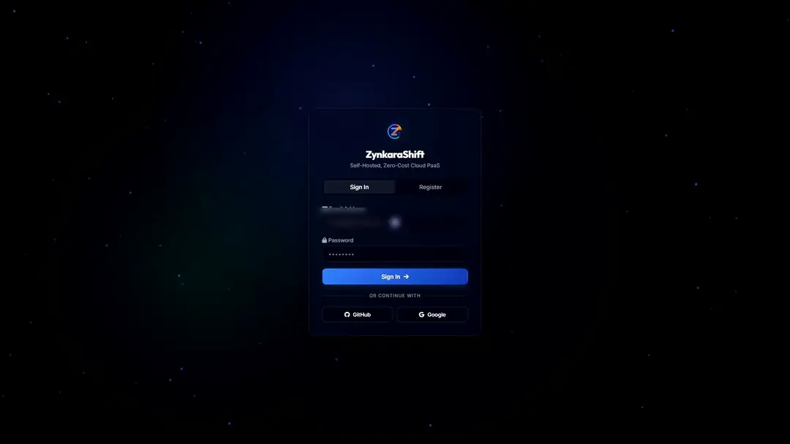
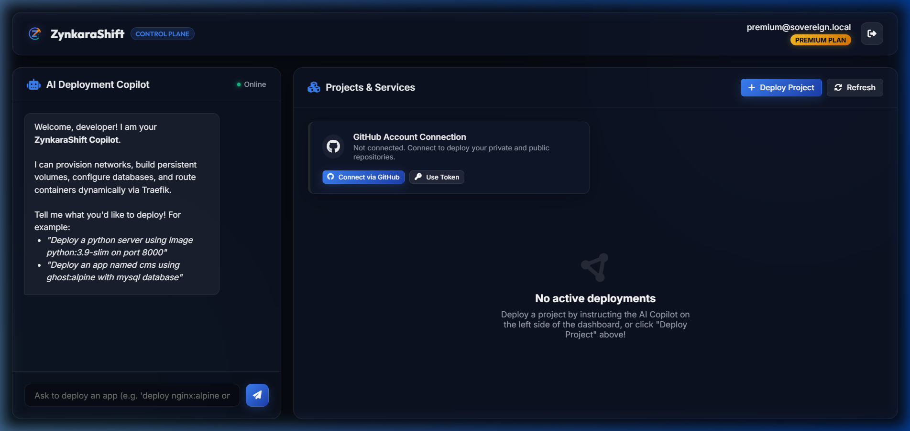
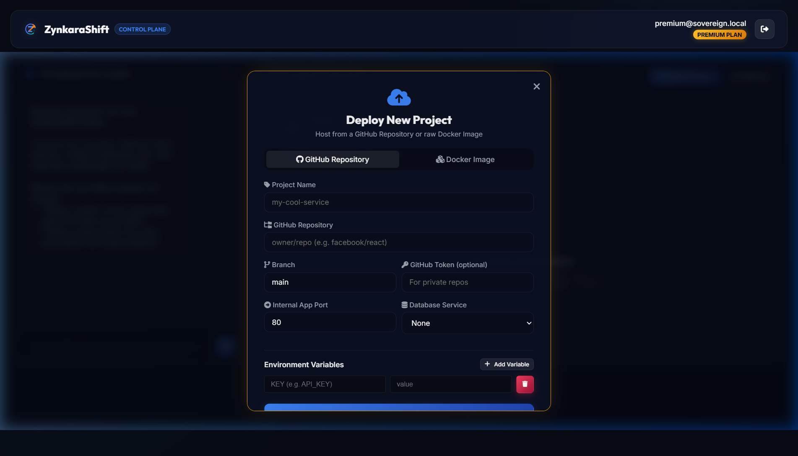

<h1 align="center">☁️ ZynkaraShift</h1>

<p align="center">
  <b>A self-hosted, single-node PaaS. Push a Git repo or Docker image, get a live HTTPS subdomain in minutes.</b>
</p>

<p align="center">
  <a href="https://zynkarashift.me/"><b>🔗 Live</b></a> ·
  <a href="#-quickstart-3-commands">Quickstart</a> ·
  <a href="#-system-architecture">Architecture</a> ·
  <a href="#-design-decisions">Design Decisions</a> ·
  <a href="#-roadmap">Roadmap</a>
</p>

<p align="center">
  
  
  
  
  
  
</p>

<p align="center">
  
</p>

> ⭐ **If this project helps you learn how a PaaS works, please star the repo. It really helps!**

---

## 💡 Why I Built This

Platforms like Heroku, Vercel, and Render make deployment look like magic. I wanted to understand what happens underneath: how a Git URL becomes a running container, how subdomains and TLS appear automatically, and how one server can safely host many apps.

ZynkaraShift is my answer: a working single-node PaaS built from Docker, Traefik, Node.js, and PostgreSQL, with an honest [list of its limitations](#%EF%B8%8F-known-limitations).

---

## ✨ Features

| | Feature | What it does |
|---|---|---|
| 🚀 | **Deploy from Git or Docker** | Deploy a Docker Hub image or connect a Git repository. |
| 📦 | **Zero-Config Buildpacks** | Detects Next.js, React SPA, Vite, Vue/Nuxt, Python, Go, Rust, and static HTML, then generates a multi-stage production Dockerfile on the fly. |
| 🤖 | **AI Deployment Copilot** | Deploy in plain English: *"Deploy image nginx:alpine name app-1 with postgres"*. |
| 🌐 | **Automatic subdomains + HTTPS** | Traefik discovers containers dynamically (no reloads) and issues Let's Encrypt certificates. |
| 🗄️ | **One-click databases** | Provision PostgreSQL, MySQL, MongoDB, or Redis with host-persisted volumes. |
| 🔒 | **Per-project network isolation** | Each project gets its own private network. Database containers expose **zero** host ports. |
| 📏 | **Resource caps and sandboxing** | 512 MB RAM (+512 MB swap), 0.5 CPU, PID limits, all Linux capabilities dropped, `no-new-privileges`. |
| ⏱️ | **Self-healing watchdog** | Monitors every new deployment for 30 seconds and rolls back to the last stable image on a crash loop. |
| 🔐 | **Auth and access control** | Email verification (SMTP), disposable-email blocking, Google and GitHub OAuth, rate limiting, and admin approval for new users. |
| 💳 | **Tiered limits** | Free tier allows 3 active projects. The upgrade flow is simulated (demo only). |

---

## 📸 Screenshots

| Dashboard and AI Copilot | Project Deployment Modal |
|:---:|:---:|
|  |  |

---

## 🧱 Tech Stack

| Layer | Technology |
|---|---|
| Control Plane API | Node.js, Express, Dockerode, `pg` |
| Control Plane Database | PostgreSQL 15 |
| Reverse Proxy and Ingress | Traefik v2.11 (Docker provider, ACME / Let's Encrypt) |
| Container Engine | Docker, Docker Compose |
| Frontend Dashboard | React 19, Vite, vanilla CSS |
| Build Engine | Built-in multi-stage Dockerfile synthesizer |
| Deployment Targets | Localhost (Docker Desktop) and Azure Linux VMs |

---

## 🚀 Quickstart (3 commands)

**Prerequisites:** [Docker Desktop](https://www.docker.com/products/docker-desktop/) (Windows / macOS) or [Docker Engine](https://docs.docker.com/engine/) with Compose v2 (Linux).

```bash
git clone https://github.com/MEHTHAB-N-M/Zynkara_Shift.git && cd Zynkara_Shift
cp .env.production.example .env   # then edit: DB password, JWT_SECRET, PLATFORM_DOMAIN
docker compose up -d
```

Create the admin account:

```bash
docker compose exec control-plane-api node create_admin.js
```

Open the dashboard at **http://localhost:8000** (or `http://zynkara.localhost`). For a public domain, point DNS at your server and set `PLATFORM_DOMAIN` in `.env`.

> 🔑 Always generate a strong, random `JWT_SECRET` and database password before hosting publicly.

### Try it in 60 seconds

1. Sign up, then approve your account as admin.
2. In the AI Copilot, type: `Deploy image nginx:alpine name web-preview port 80`
3. Watch the build logs stream, then visit `http://web-preview.localhost`.

---

## 🧱 System Architecture

```text
┌────────────────────────────────────────────────────────┐
│                   Public Web Client                    │
└───────────────────────────┬────────────────────────────┘
                            │  HTTP / HTTPS (*.your-domain / *.localhost)
                            ▼
┌────────────────────────────────────────────────────────┐
│                 Traefik Reverse Proxy                  │
│          (Let's Encrypt ACME TLS · ports 80/443)       │
└───────────────────────────┬────────────────────────────┘
                            │
┌───────────────────────────┴────────────────────────────┐
│          Shared network: zynkara-traefik-net           │
└───────────────────────────┬────────────────────────────┘
                            ▼
┌────────────────────────────────────────────────────────┐
│       Private network: zynkara-project-{id}            │
│                                                        │
│  ┌──────────────────────┐     ┌─────────────────────┐  │
│  │    App Container     │◄───►│    DB Container     │  │
│  │  zynkara-app-{id}    │     │   zynkara-db-{id}   │  │
│  │  512 MB · 0.5 CPU    │     │  Postgres / MySQL / │  │
│  │  Traefik labels      │     │  MongoDB / Redis    │  │
│  │                      │     │  No exposed ports   │  │
│  └──────────────────────┘     └─────────────────────┘  │
└────────────────────────────────────────────────────────┘
```

**Key points**
- The **app container** joins two networks: `zynkara-traefik-net` (incoming traffic) and `zynkara-project-{id}` (database access).
- The **database container** joins only `zynkara-project-{id}`, so it is unreachable from the internet and from other projects' databases.
- Apps reach their database through Docker's internal DNS (`db-service`).
- Database data is bind-mounted to `/var/zynkara/volumes/{owner_id}/{project_id}/{db_type}`.

---

## 🧠 Design Decisions

**Why Traefik?** Its Docker provider reads container labels from the Docker socket, so a new app gets a route and TLS certificate the moment it starts. No config files, no proxy reloads, no downtime for other apps.

**Why a private network per project?** A database should never be reachable from the host or from other tenants. Putting each project's app and database on their own bridge network, with no published ports, makes that the default.

**Why a buildpack engine?** `buildpacks.js` inspects `package.json`, `requirements.txt`, `go.mod`, `Cargo.toml`, and similar files, then writes a lean multi-stage Dockerfile with the right port (for example 3000 for Next.js, 80 for static sites). Users deploy code without writing Docker config.

**Why a watchdog?** A container that starts is not always a container that works. `watchdog.js` watches each new deployment for 30 seconds. If it detects a crash loop or a non-zero exit, it rolls back to the previous stable image and records diagnostics in the deployment log.

**Why hard resource limits?** On a small shared server, one runaway app can take everything down. Every container gets memory, CPU, and PID caps, drops all Linux capabilities, and runs with `no-new-privileges` to limit fork bombs and privilege escalation.

**How does access control work?** New users register as `pending` and an admin approves them. Free accounts can run 3 active projects. A 4th deployment returns `403 Forbidden`:

```json
{
  "error": "Subscription required",
  "message": "You have reached the maximum limit of 3 free deployed projects. Please upgrade to a premium tier to unlock unlimited deployments."
}
```

---

## ✅ Verify It Works

1. **Isolated databases:** deploy an app with PostgreSQL attached, then run `docker inspect zynkara-db-<project_id>`. Confirm no host ports are published and only `zynkara-project-<project_id>` is attached.
2. **Free-tier limit:** deploy 3 apps on a free account, attempt a 4th, and confirm the `403` response and upgrade overlay.
3. **Watchdog rollback:** deploy an image that exits immediately and watch the platform roll back to the previous stable build.

---

## ☁️ Cloud Deployment

To run ZynkaraShift on an Azure VM or any Linux VPS with Let's Encrypt SSL and firewall rules, see:

- [AZURE_DEPLOYMENT.md](AZURE_DEPLOYMENT.md)
- [deploy-azure.sh](deploy-azure.sh)

---

## ⚠️ Known Limitations

ZynkaraShift is a single-node platform built to learn how PaaS systems work. Signups are invite-only (admin approval) because of the limits below. **It is not ready to run untrusted code in production.**

- **Shared ingress network:** app containers join `zynkara-traefik-net`, so apps from different tenants can reach each other there. Per-project networks protect databases, not app-to-app traffic.
- **Memory overcommit:** each container is capped at 512 MB, but the host is a 1 GB VM (+ swap), so only a few apps run at once.
- **Docker socket access:** Traefik and the control plane mount `/var/run/docker.sock`, which is root-equivalent on the host.
- **Untrusted builds:** Git builds run user-supplied Dockerfiles with no build timeout or size limits.
- **Cloud metadata:** tenant containers are not blocked from the Azure metadata endpoint (`169.254.169.254`).
- **Certificates:** per-subdomain Let's Encrypt certificates can hit rate limits at scale.
- **Billing is simulated:** the Stripe upgrade flow is a demo.

---

## 🗺️ Roadmap

Ideas for turning the limitations above into improvements:

- [ ] Build timeouts and image size limits
- [ ] Block tenant access to the cloud metadata endpoint (`169.254.169.254`)
- [ ] Isolate apps from each other (per-tenant ingress networks)
- [ ] Replace direct Docker socket mounts with a restricted socket proxy
- [ ] Real Stripe billing
- [ ] Wildcard certificates to avoid Let's Encrypt rate limits
- [ ] Multi-node support

---

## 🤝 Feedback

Found a bug or have an idea? [Open an issue](https://github.com/MEHTHAB-N-M/Zynkara_Shift/issues). Feedback is welcome, and I read every one.

---

## 📄 License

All rights reserved. Source available for viewing and evaluation only.
See the [LICENSE](LICENSE) file for details.

---

## 👤 Author

**Mehthab N M**, Full-Stack Developer (Python, Django, React)

[Portfolio](https://mehthab-n-m.github.io/My_portfolio/) · [LinkedIn](https://www.linkedin.com/in/mehthab-n-m-637611344) · [GitHub](https://github.com/MEHTHAB-N-M)

⭐ **If you found this useful, a star means a lot.**
